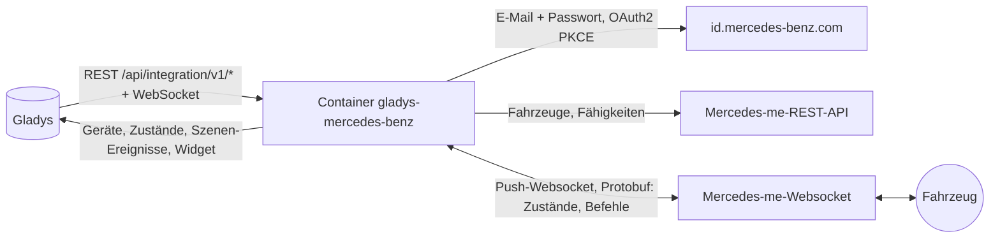
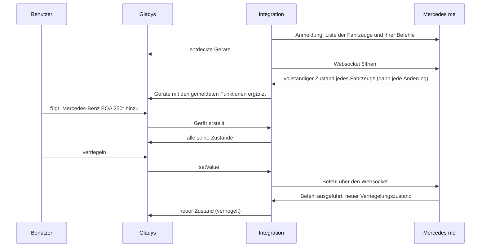
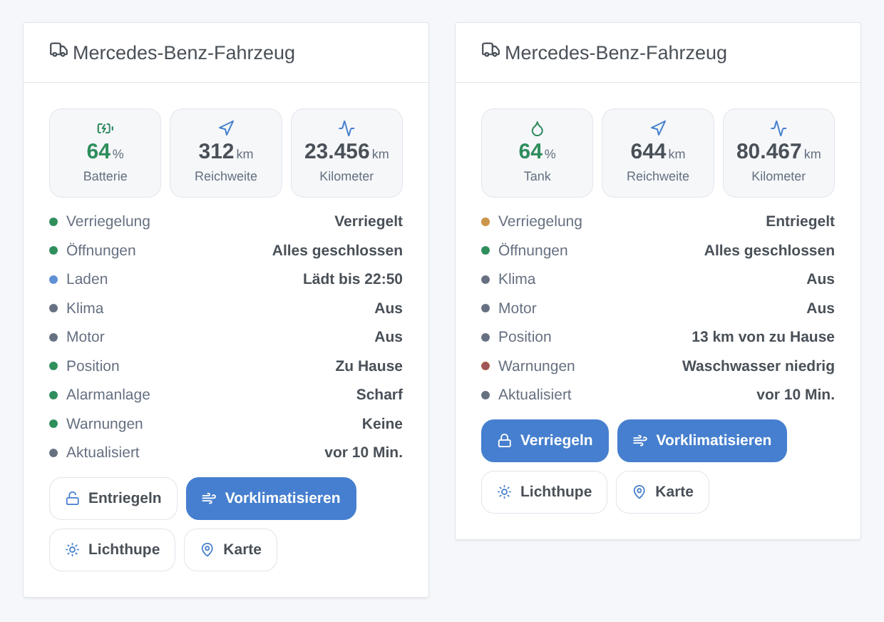

# Gladys Mercedes-Benz

[English](README.md) · [Français](README.fr.md) · **Deutsch** · [Español](README.es.md)

[](LICENSE)
[](https://github.com/William-De71/gladys-mercedes-benz/releases)
[](https://github.com/William-De71/gladys-mercedes-benz/actions/workflows/release.yml)
[](https://gladysassistant.com)


Externe Integration für [Gladys Assistant](https://gladysassistant.com) für **Mercedes-Benz-Fahrzeuge** mit Mercedes me: Batterie oder Tank, Reichweite, Kilometerstand, Verriegelung, Öffnungen, Laden, Klimatisierung, Alarmanlage, Reifen, Position, mit Befehlen, Szenen und einem Dashboard-Widget. Sie spricht mit Ihrem Konto mit den Servern der Mercedes-me-App, wie die Home-Assistant-Integration [mbapi2020](https://github.com/ReneNulschDE/mbapi2020).

Benutzerdokumentation: [English](docs/en.md) · [Français](docs/fr.md) · [Deutsch](docs/de.md) · [Español](docs/es.md).

> Community-Integration, weder mit der Mercedes-Benz Group AG verbunden noch von ihr unterstützt. Die Mercedes-me-Server haben keine öffentliche Dokumentation: Mercedes kann sie jederzeit ändern.

## Funktionen

- **Ein Gerät pro Fahrzeug** des Kontos (eigene und geteilte Fahrzeuge): Batterie und elektrische Reichweite, Tank und Reichweite, Kilometerstand, Verriegelung, Diebstahlwarnanlage, Türen, Kofferraum, Motorhaube, Fenster, Schiebedach, Ladekabel, Laden, Ladestatus und -leistung, Ladelimit, Vorklimatisierung, Druck der vier Reifen, Wartung, Warnungen, Entfernung von zu Hause.
- **Befehle**, wenn das Fahrzeug sie annimmt: verriegeln, entriegeln (mit der Sicherheits-PIN), Vorklimatisierung (oder Standheizung), Ladelimit, Lichter blinken lassen, Hupe, Fenster schließen.
- **Live-Aktualisierung**: Mercedes sendet jede Änderung über einen Websocket.
- **9 Szenen-Auslöser**, **2 Szenen-Aktionen** und **1 Dashboard-Widget** (siehe unten).
- Eine Schaltfläche **Diagnose**, die ins Protokoll schreibt, was jedes Fahrzeug meldet, ohne FIN, Kennzeichen und Position.
- Überall vier Sprachen: Englisch, Französisch, Deutsch, Spanisch.

## Funktionsweise




Vom Scan zum Befehl:



Mercedes sperrt ein Konto, dessen Websocket täglich zu lange offen bleibt (HTTP 429, oft bis Mitternacht GMT). Wie mbapi2020 öffnet die Integration kurze Sitzungen: Sie liest die Änderungen, schließt nach 30 Sekunden Ruhe und öffnet nach der Pause aus den Einstellungen wieder (standardmäßig 1 Minute); bei laufendem Motor oder solange ein Befehl auf Antwort wartet, bleibt sie offen. Solange Mercedes den Websocket ablehnt, werden die Fahrzeuge alle 10 Minuten über die REST-API gelesen.

Die Anmeldung ist die der App: E-Mail, Passwort, dann der Code-Austausch (OAuth2 + PKCE). Die Integration lehnt das Passkey-Angebot ab, akzeptiert aktualisierte Bedingungen, wenn Mercedes danach fragt, behält die Tokens in `/data/session.json` und meldet sich selbst neu an, wenn die Sitzung endet (etwa alle 18 Stunden). Zwei-Faktor-Authentifizierung funktioniert so nicht: Verwenden Sie ein Konto ohne.

### Transport

`transports: ["cloud"]`: Alles läuft über die Mercedes-Server, das Fahrzeug wird nie in Ihrem Netzwerk erreicht. Der Zustand Ihrer Fahrzeuge (inklusive Position) kommt aus der Mercedes-Cloud; die Integration sendet Mercedes Ihre E-Mail, Ihr Passwort und die Befehle. Das Transport-Abzeichen eines Fahrzeugs zeigt `cloud`, `unreachable`, wenn Mercedes das Konto ablehnt, und den orangefarbenen Punkt des eingeschränkten Modus, solange der Websocket gesperrt ist.

## Geräte und Funktionen

| Gerät                  | Funktionen (Kategorie / Typ)                                                                                                                                                                                                                                                                                                                                                                                                                                                                                                                                                                                                                                                                                                                                          |
| ---------------------- | --------------------------------------------------------------------------------------------------------------------------------------------------------------------------------------------------------------------------------------------------------------------------------------------------------------------------------------------------------------------------------------------------------------------------------------------------------------------------------------------------------------------------------------------------------------------------------------------------------------------------------------------------------------------------------------------------------------------------------------------------------------------- |
| Mercedes-Benz-Fahrzeug | Batterie (`electrical-vehicle-battery` / `battery-level`), elektrische Reichweite (`battery-range-estimate`), Tankfüllstand (`level-sensor` / `liquid-level-percent`), Kraftstoffreichweite und Strecke bis zur Wartung (`distance-sensor` / `decimal`, km), Kilometerstand (`electrical-vehicle-state` / `odometer`), Verriegelung und Alarmanlage (`electrical-vehicle-command`), Türen, Kofferraum, Motorhaube (`door-opened`), Fenster, Schiebedach (`window-opened`), Reifendruck (`tire-pressure`, bar), Kabel angeschlossen, Laden, Ladeleistung, Ladelimit (`electrical-vehicle-charge`), Vorklimatisierung (`electrical-vehicle-climate` / `climate-on`), Tage bis zur Wartung (`duration`), Ladestatus und Warnungen (`text`), Entfernung von zu Hause (km) |

Eine Funktion erscheint, sobald das Fahrzeug ihren Wert meldet: Starten Sie nach den ersten Daten eine neue Suche, falls eine fehlt. Verriegelung, Vorklimatisierung und Ladelimit sind Befehle, wenn das Fahrzeug sie annimmt, sonst nur lesbar.

## Szenen-Auslöser, -Aktionen und Widgets



- **Auslöser**: ver- oder entriegelt, verriegelt, aber offen, Diebstahlalarm, Motor an oder aus, Ladestatus geändert, Kabel an- oder abgesteckt, angekommen oder weg (Häuser in Gladys mit Position, Radius aus den Einstellungen), neue Warnung, Kontoproblem (Passwort, Code verlangt, gesperrt, App-Version abgelehnt). Jeder Fahrzeug-Auslöser lässt sich nach Fahrzeug filtern.
- **Aktionen**: Befehl senden (wartet bis zu 90 s auf die Antwort des Fahrzeugs: `success`, `status`, `summary`), Status lesen (Verriegelung, Öffnungen, Batterie, Tank, Reichweite, Laden, Position, Kartenlink, Warnungen, ein fertiger Satz).
- **Widget** „Mercedes-Benz-Fahrzeug“: Batterie oder Tank, Reichweite, Kilometerstand, Statusliste, Tasten ver-/entriegeln, vorklimatisieren, Lichthupe, Karte.

Beispiele:

- Wenn das Fahrzeug verriegelt, aber offen ist → eine Benachrichtigung mit `{{triggerEvent.data.summary}}` senden.
- Wenn der Ladestatus „Geladen“ wird → benachrichtigen und die Ladesteckdose ausschalten.
- An Wintermorgen werktags um 7:30 → den Befehl „Vorklimatisierung starten“ senden.
- Wenn das Fahrzeug zu Hause ankommt → das Garagentor öffnen und die Eingangsbeleuchtung einschalten.

## Voraussetzungen

- Gladys Assistant **5.3.0** oder neuer (Katalog-Suchbegriffe von Gladys 5.3, Widgets und Szenen): Ältere Instanzen können die Integration nicht installieren.
- Ein Mercedes-Benz-Fahrzeug mit Mercedes me (in Nordamerika Mercedes me connect) und das Konto der App, einmal in der App angemeldet, **ohne Zwei-Faktor-Authentifizierung**. Empfohlen wird ein zweites Konto, das der Hauptnutzer zum Fahrzeug einlädt.
- Regionen: Europa (auch Indien und Thailand), Nordamerika (Fahrzeuge ab 2019), Asien-Pazifik (auch Lateinamerika). China wird nicht unterstützt.

## Installation

- **Aus dem Store**: Integrationen → Mercedes-Benz → Installieren.
- **Über die Repository-URL**: Integrationen → externe Integration → `https://github.com/William-De71/gladys-mercedes-benz`.
- **Entwicklermodus**: `npm start` mit den von Gladys gelieferten Variablen starten (siehe Entwicklung).

## Konfiguration

| Feld                         | Standard    | Bedeutung                                                               |
| ---------------------------- | ----------- | ----------------------------------------------------------------------- |
| E-Mail / Passwort            | —           | Das Mercedes-me-Konto (das Passwort ist ein `secret`)                   |
| Region                       | Europa      | Europa, Nordamerika, Asien-Pazifik                                      |
| Sicherheits-PIN              | —           | Die PIN der App, nur zum Entriegeln aus Gladys                          |
| Pause zwischen zwei Abfragen | 1 Min.      | 1 bis 30 Min. zwischen zwei Websocket-Sitzungen                         |
| Radius um das Zuhause        | 200 m       | Entfernung zu einem Haus in Gladys, unter der das Fahrzeug zu Hause ist |
| Sprache der Texte            | automatisch | Namen, Zustände und Szenen-Zusammenfassungen                            |
| App-Version / SDK (Erw.)     | leer        | Nur wenn Mercedes die eingebaute App-Version ablehnt (Fehler 418)       |

## Verwendung

1. Konto eintragen, auf **Speichern** klicken, dann auf **Verbindung testen**.
2. **Entdecken**, dann Ihre Fahrzeuge hinzufügen.
3. Das Widget einem Dashboard hinzufügen und Szenen mit den Auslösern und Aktionen erstellen.

## Entwicklung

```bash
npm install
npm test                       # node --test, ohne Netzwerkzugriff
npm run lint                   # ESLint
npm run format:check           # Prettier
npx github:GladysAssistant/integration-store . --skip-image-check
scripts/build-cover.sh         # cover.jpg aus docs/assets/cover.svg
docs/illustrations/render.sh   # docs/assets/widgets.<sprache>.png
```

Lokal liest das SDK `GLADYS_HOST_API_URL`, `GLADYS_INTEGRATION_TOKEN` und `GLADYS_INTEGRATION_SELECTOR` (von Gladys im Entwicklermodus geliefert). `DEBUG=gladys-integration-sdk` zeigt die Protokolle des SDK.

`src/mercedes/proto.json` ist das Protobuf-Schema der App, mit `scripts/proto/` aus mbapi2020 erzeugt (siehe die Kommentare dort). Die Tests bauen ihre Nachrichten damit (synthetische Fahrzeuge, falsche FIN): Anmeldeschritte (Passkey, 2FA, falsches Passwort, Erneuerung, gespeicherte Sitzung), Websocket-Sitzungen (Bestätigungen, Befehle, 429, 418), beide Nachrichtenformen (VEP und VSU), die Geräte (Pflichtfelder der Entdeckung, Kategorie-/Typ-Paare und Einheiten des Kerns), das Widget (`validateWidgetContent`), Szenen-Ereignisse und -Ausgaben, das Manifest, die vier Sprachen, das Release-Skript und die ganze Integration gegen das Fake-Gladys des SDK. `test/structure.test.js` friert jeden gespeicherten Schlüssel ein.

## Release-Prozess


Jeder Merge auf `main` startet die CI und berechnet dann die Version aus den [Conventional Commits](https://www.conventionalcommits.org/de/) seit dem letzten Tag: `feat` → Minor, `fix` / `perf` → Patch, `!` oder `BREAKING CHANGE` → Major (unter 1.0.0 ein Minor); `docs`, `chore`, `ci`, `test`, `style`, `refactor`, `build` allein veröffentlichen nichts. Der Changelog-Abschnitt wird erzeugt, der Tag gepusht, das Multi-Architektur-Image gebaut, dann erhält `main` den Release-Commit, das GitHub Release wird erstellt und ein letzter Job prüft das öffentliche Image, den Store-Validator und das Topic.

- Der Titel des Pull Requests wird zum Squash-Commit und dann zur Changelog-Zeile: auf Englisch, für den Nutzer schreiben (`pr-title.yml` prüft ihn). `CHANGELOG.md` nie von Hand bearbeiten.
- 1.0.0 ist eine Entscheidung: Actions → Release → Run workflow mit `release-as: 1.0.0`. `dry-run` zeigt Version und Notizen, ohne zu veröffentlichen.
- **Geschützter Branch**: Das Release pusht seinen Commit mit `GITHUB_TOKEN` auf `main`. Mit einem Ruleset auf `main` GitHub Actions in die Bypass-Liste aufnehmen (oder über eine GitHub App pushen), sonst scheitert der Veröffentlichungs-Job mit Anweisungen.
- Nach dem ersten Release das Paket `ghcr.io` öffentlich machen (Package settings → Change visibility), sonst kann Gladys es nicht laden.

## Fehlerbehebung

Siehe [docs/de.md](docs/de.md#fehlerbehebung). Probleme mit den Versionen von Gladys und der Integration, Modell, Baujahr und Region des Fahrzeugs und den Protokollen nach einem Klick auf **Diagnose** melden.

## Mitwirken

Issues und Pull Requests sind willkommen. Vor einem Pull Request `npm run format:check && npm run lint && npm test` ausführen und alle External IDs und gespeicherten Schlüssel unverändert lassen (siehe [CLAUDE.md](CLAUDE.md)). Wenn Mercedes die verlangte App-Version ändert, `src/mercedes/constants.js` nach dem Projekt mbapi2020 anpassen.

## Sicherheit

Siehe [SECURITY.md](SECURITY.md): Schwachstellen privat melden. Passwort und PIN sind `secret`-Felder und werden nie protokolliert; die Tokens bleiben in `/data/session.json` (Modus 600); eine FIN wird in den Protokollen gekürzt, und die Diagnose lässt FIN, Kennzeichen und Position weg.

## Kommende Screenshots

Die Bilder oben sind Illustrationen, keine Screenshots. Echte Screenshots kommen nach `docs/assets/screenshots/` (PNG, 1280 × 800): `configuration.png`, `discovery.png`, `device.png`, `scene.png`.

## Lizenz

[Apache-Lizenz 2.0](LICENSE) — siehe auch [NOTICE](NOTICE). Das Protobuf-Schema `src/mercedes/proto.json` stammt aus mbapi2020 unter der MIT-Lizenz ([PROTO-LICENSE](src/mercedes/PROTO-LICENSE)). Mercedes-Benz und Mercedes me sind Marken der Mercedes-Benz Group AG; diese Community-Integration ist nicht mit ihr verbunden. Dank an die Dokumentation und das SDK von Gladys sowie an René Nulsch und die Mitwirkenden von mbapi2020.
