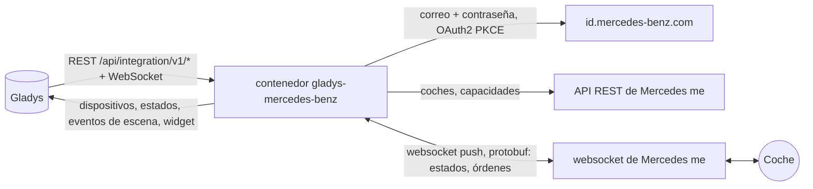
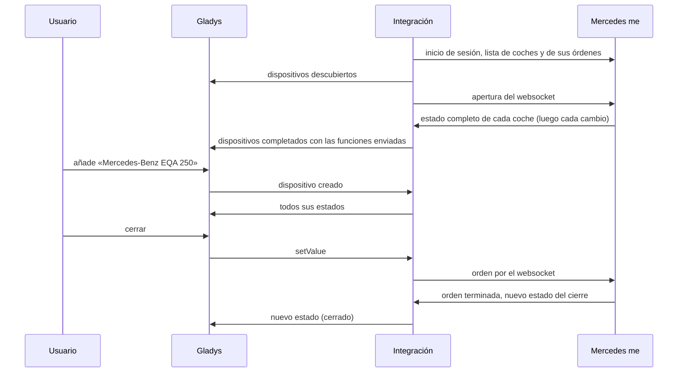
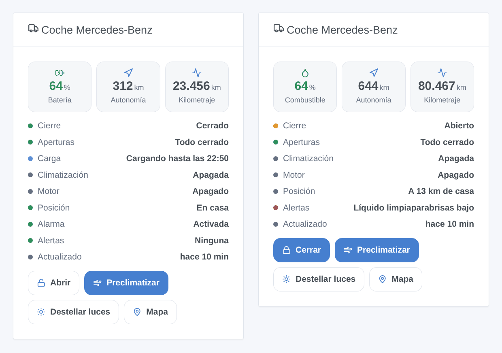

# Gladys Mercedes-Benz

[English](README.md) · [Français](README.fr.md) · [Deutsch](README.de.md) · **Español**

[](LICENSE)
[](https://github.com/William-De71/gladys-mercedes-benz/releases)
[](https://github.com/William-De71/gladys-mercedes-benz/actions/workflows/release.yml)
[](https://gladysassistant.com)


Integración externa de [Gladys Assistant](https://gladysassistant.com) para los **coches Mercedes-Benz** conectados a Mercedes me: batería o combustible, autonomía, kilometraje, cierre, aperturas, carga, climatización, alarma, neumáticos, posición, con órdenes, escenas y un widget de panel. Habla con los servidores de la app Mercedes me con su cuenta, como la integración de Home Assistant [mbapi2020](https://github.com/ReneNulschDE/mbapi2020).

Documentación de usuario: [English](docs/en.md) · [Français](docs/fr.md) · [Deutsch](docs/de.md) · [Español](docs/es.md).

> Integración comunitaria, sin vínculo con Mercedes-Benz Group AG ni respaldo de su parte. Los servidores de Mercedes me no tienen documentación pública: Mercedes puede cambiarlos en cualquier momento.

## Funciones

- **Un dispositivo por coche** de la cuenta (coches propios y compartidos): batería y autonomía eléctrica, combustible y autonomía, kilometraje, cierre, alarma antirrobo, puertas, maletero, capó, ventanillas, techo solar, cable de carga, carga en curso, estado y potencia de carga, límite de carga, preclimatización, presión de los cuatro neumáticos, mantenimiento, alertas, distancia de casa.
- **Órdenes** cuando el coche las acepta: cerrar, abrir (con el PIN de seguridad), preclimatización (o calefacción auxiliar), límite de carga, destellar las luces, claxon, cerrar las ventanillas.
- **Actualización en directo**: Mercedes envía cada cambio por un websocket.
- **9 disparadores de escena**, **2 acciones de escena** y **1 widget** de panel (abajo).
- Un botón **Diagnóstico** que escribe en los registros lo que envía cada coche, sin VIN, matrícula ni posición.
- Cuatro idiomas en todas partes: inglés, francés, alemán, español.

## Funcionamiento




Del escaneo a una orden:



Mercedes bloquea una cuenta cuyo websocket queda abierto demasiado tiempo en un día (HTTP 429, a menudo hasta medianoche GMT). Como mbapi2020, la integración abre sesiones cortas: lee los cambios, cierra tras 30 segundos sin mensajes y vuelve a abrir tras la pausa de los ajustes (1 minuto por defecto); sigue abierta con el motor en marcha o mientras una orden espera su respuesta. Mientras Mercedes rechaza el websocket, los coches se leen por la API REST cada 10 minutos.

El inicio de sesión es el de la app: correo, contraseña y luego el intercambio del código (OAuth2 + PKCE). La integración rechaza la propuesta de passkey, acepta las condiciones actualizadas cuando Mercedes las pide, guarda los tokens en `/data/session.json` y vuelve a iniciar sesión sola cuando la sesión termina (cada 18 horas aproximadamente). La doble autenticación no puede funcionar así: use una cuenta que no la tenga.

### Transporte

`transports: ["cloud"]`: todo pasa por los servidores de Mercedes, el coche nunca se alcanza en su red. El estado de sus coches (posición incluida) viene de la nube de Mercedes; la integración envía a Mercedes su correo, su contraseña y las órdenes. La insignia de transporte de un coche indica `cloud`, `unreachable` cuando Mercedes rechaza la cuenta, y muestra el punto naranja del modo degradado mientras el websocket está bloqueado.

## Dispositivos y funciones

| Dispositivo         | Funciones (categoría / tipo)                                                                                                                                                                                                                                                                                                                                                                                                                                                                                                                                                                                                                                                                                                                                                                        |
| ------------------- | --------------------------------------------------------------------------------------------------------------------------------------------------------------------------------------------------------------------------------------------------------------------------------------------------------------------------------------------------------------------------------------------------------------------------------------------------------------------------------------------------------------------------------------------------------------------------------------------------------------------------------------------------------------------------------------------------------------------------------------------------------------------------------------------------- |
| Coche Mercedes-Benz | batería (`electrical-vehicle-battery` / `battery-level`), autonomía eléctrica (`battery-range-estimate`), nivel de combustible (`level-sensor` / `liquid-level-percent`), autonomía de combustible y distancia hasta el mantenimiento (`distance-sensor` / `decimal`, km), kilometraje (`electrical-vehicle-state` / `odometer`), cierre y alarma (`electrical-vehicle-command`), puertas, maletero, capó (`door-opened`), ventanillas, techo solar (`window-opened`), presión de los neumáticos (`tire-pressure`, bar), cable enchufado, carga en curso, potencia de carga, límite de carga (`electrical-vehicle-charge`), preclimatización (`electrical-vehicle-climate` / `climate-on`), días hasta el mantenimiento (`duration`), estado de la carga y alertas (`text`), distancia de casa (km) |

Una función aparece en cuanto el coche envía su valor: vuelva a descubrir tras los primeros datos si falta alguna. Cierre, preclimatización y límite de carga son órdenes cuando el coche las acepta, solo lectura en caso contrario.

## Disparadores, acciones de escena y widgets



- **Disparadores**: cerrado o abierto, cerrado pero abierto, alarma antirrobo, motor arrancado o apagado, estado de carga cambiado, cable enchufado o no, llegada o salida (viviendas de Gladys con posición, radio de los ajustes), nueva alerta, problema de cuenta (contraseña, código pedido, bloqueo, versión de la app rechazada). Cada disparador de coche se puede filtrar por coche.
- **Acciones**: enviar una orden (espera hasta 90 s la respuesta del coche: `success`, `status`, `summary`), leer el estado (cierre, aperturas, batería, combustible, autonomía, carga, posición, enlace al mapa, alertas, una frase lista).
- **Widget** «Coche Mercedes-Benz»: batería o combustible, autonomía, kilometraje, lista de estados, botones cerrar/abrir, preclimatizar, destellar luces, mapa.

Ejemplos:

- Cuando el coche está cerrado pero abierto → enviar una notificación con `{{triggerEvent.data.summary}}`.
- Cuando el estado de carga pasa a «Cargado» → avisar y apagar el enchufe de carga.
- Las mañanas de invierno a las 7:30 en días laborables → enviar la orden «Iniciar la preclimatización».
- Cuando el coche llega a casa → abrir la puerta del garaje y encender la luz de la entrada.

## Requisitos

- Gladys Assistant **5.1.0** o posterior (widgets y escenas): las instancias más antiguas no pueden instalar la integración.
- Un coche Mercedes-Benz conectado a Mercedes me (Mercedes me connect en Norteamérica) y la cuenta de la app, con la sesión iniciada una vez en la app, **sin doble autenticación**. Se recomienda una segunda cuenta invitada al coche por su usuario principal.
- Regiones: Europa (también India y Tailandia), Norteamérica (coches de 2019 en adelante), Asia-Pacífico (también Latinoamérica). China no es compatible.

## Instalación

- **Desde la tienda**: Integraciones → Mercedes-Benz → Instalar.
- **Desde la URL del repositorio**: Integraciones → integración externa → `https://github.com/William-De71/gladys-mercedes-benz`.
- **Modo desarrollador**: ejecute `npm start` con las variables que da Gladys (ver Desarrollo).

## Configuración

| Campo                         | Por defecto | Significado                                                           |
| ----------------------------- | ----------- | --------------------------------------------------------------------- |
| Correo / Contraseña           | —           | La cuenta Mercedes me (la contraseña es un `secret`)                  |
| Región                        | Europa      | Europa, Norteamérica, Asia-Pacífico                                   |
| PIN de seguridad              | —           | El PIN de la app, solo para abrir desde Gladys                        |
| Pausa entre lecturas          | 1 min       | 1 a 30 min entre dos sesiones del websocket                           |
| Radio de la vivienda          | 200 m       | Distancia a una vivienda de Gladys bajo la cual el coche está en casa |
| Idioma de los textos          | automático  | Nombres, estados y resúmenes de escenas                               |
| Versión de la app / SDK (Av.) | vacío       | Solo si Mercedes rechaza la versión integrada (error 418)             |

## Uso

1. Indique la cuenta, haga clic en **Guardar** y luego en **Probar la conexión**.
2. **Descubra** y añada sus coches.
3. Añada el widget a un panel y cree escenas con los disparadores y las acciones.

## Desarrollo

```bash
npm install
npm test                       # node --test, nunca toca la red
npm run lint                   # ESLint
npm run format:check           # Prettier
npx github:GladysAssistant/integration-store . --skip-image-check
scripts/build-cover.sh         # cover.jpg desde docs/assets/cover.svg
docs/illustrations/render.sh   # docs/assets/widgets.<idioma>.png
```

En local, el SDK lee `GLADYS_HOST_API_URL`, `GLADYS_INTEGRATION_TOKEN` y `GLADYS_INTEGRATION_SELECTOR` (que da Gladys en modo desarrollador). `DEBUG=gladys-integration-sdk` muestra los registros del SDK.

`src/mercedes/proto.json` es el esquema protobuf de la app, generado desde mbapi2020 con `scripts/proto/` (ver sus comentarios). Las pruebas construyen sus mensajes con él (coches sintéticos, VIN falsos): pasos del inicio de sesión (passkey, 2FA, contraseña incorrecta, renovación, sesión guardada), sesiones del websocket (acuses, órdenes, 429, 418), las dos formas de mensajes (VEP y VSU), los dispositivos (campos que exige el descubrimiento, pares categoría / tipo y unidades del núcleo), el widget (`validateWidgetContent`), los eventos y salidas de escena, el manifiesto, los cuatro idiomas, el script de release y toda la integración frente al Gladys falso del SDK. `test/structure.test.js` congela cada clave que guardan los usuarios.

## Proceso de release


Cada fusión en `main` lanza la CI y luego calcula la versión a partir de los [Conventional Commits](https://www.conventionalcommits.org/es/) desde la última etiqueta: `feat` → menor, `fix` / `perf` → parche, `!` o `BREAKING CHANGE` → mayor (una menor por debajo de 1.0.0); `docs`, `chore`, `ci`, `test`, `style`, `refactor`, `build` solos no publican nada. Se genera la sección del changelog, se sube la etiqueta, se construye la imagen multiarquitectura, luego `main` recibe el commit de release, se crea la GitHub Release y un último job comprueba la imagen pública, el validador de la tienda y el topic.

- El título de la pull request se convierte en el commit de squash y luego en la línea del changelog: escríbalo en inglés, para el usuario (`pr-title.yml` lo comprueba). No edite nunca `CHANGELOG.md` a mano.
- La 1.0.0 es una decisión: Actions → Release → Run workflow con `release-as: 1.0.0`. `dry-run` muestra la versión y las notas sin publicar.
- **Rama protegida**: la release sube su commit a `main` con `GITHUB_TOKEN`. Con un ruleset en `main`, añada GitHub Actions a su lista de omisión (o suba mediante una GitHub App); si no, el job de publicación falla con instrucciones.
- Tras la primera release, haga público el paquete `ghcr.io` (Package settings → Change visibility); si no, Gladys no puede descargarlo.

## Solución de problemas

Ver [docs/es.md](docs/es.md#solución-de-problemas). Informe de los problemas con las versiones de Gladys y de la integración, el modelo, año y región del coche, y los registros tras un clic en **Diagnóstico**.

## Contribuir

Issues y pull requests son bienvenidas. Ejecute `npm run format:check && npm run lint && npm test` antes de abrir una pull request y mantenga sin cambios todos los external ids y claves guardadas (ver [CLAUDE.md](CLAUDE.md)). Cuando Mercedes cambie la versión de app exigida, actualice `src/mercedes/constants.js` según el proyecto mbapi2020.

## Seguridad

Ver [SECURITY.md](SECURITY.md): informe de las vulnerabilidades en privado. La contraseña y el PIN son campos `secret`, nunca registrados; los tokens quedan en `/data/session.json` (modo 600); un VIN se acorta en los registros, y el Diagnóstico omite VIN, matrícula y posición.

## Capturas por venir

Las imágenes de arriba son ilustraciones, no capturas de pantalla. Las capturas reales irán en `docs/assets/screenshots/` (PNG, 1280 × 800): `configuration.png`, `discovery.png`, `device.png`, `scene.png`.

## Licencia

[Licencia Apache 2.0](LICENSE) — ver también [NOTICE](NOTICE). El esquema protobuf `src/mercedes/proto.json` viene de mbapi2020 bajo licencia MIT ([PROTO-LICENSE](src/mercedes/PROTO-LICENSE)). Mercedes-Benz y Mercedes me son marcas de Mercedes-Benz Group AG; esta integración comunitaria no está vinculada a ella. Gracias a la documentación y al SDK de Gladys, y a René Nulsch y los contribuidores de mbapi2020.
