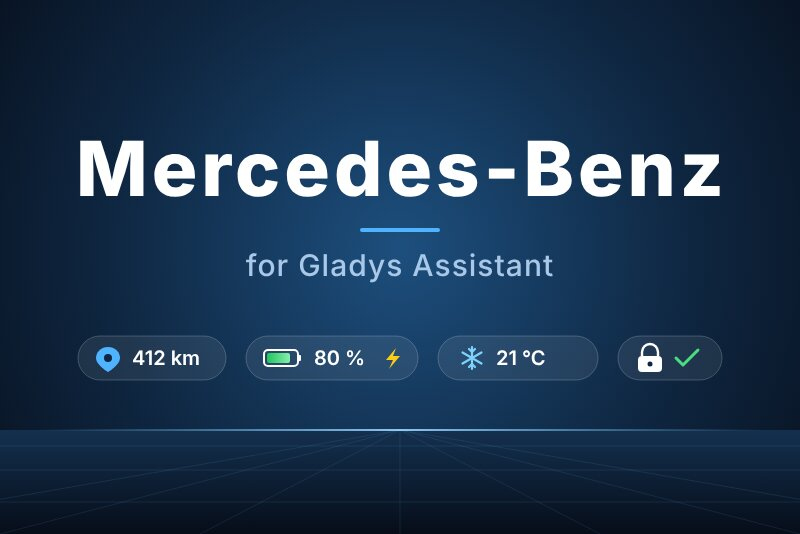
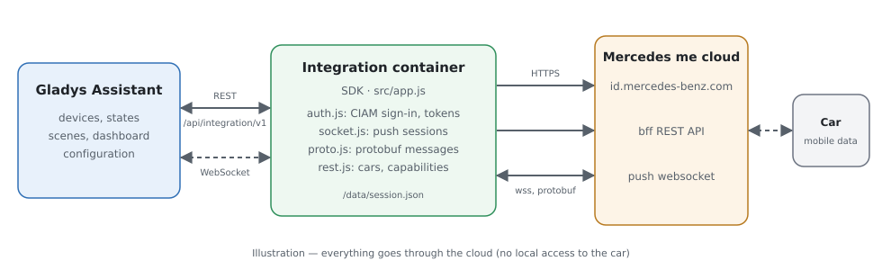
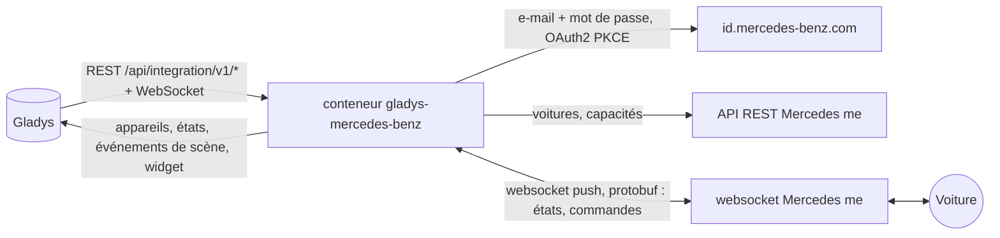
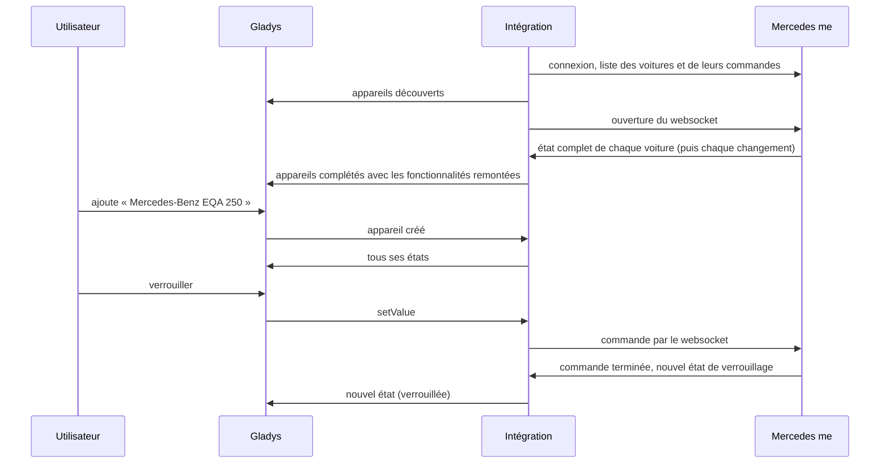
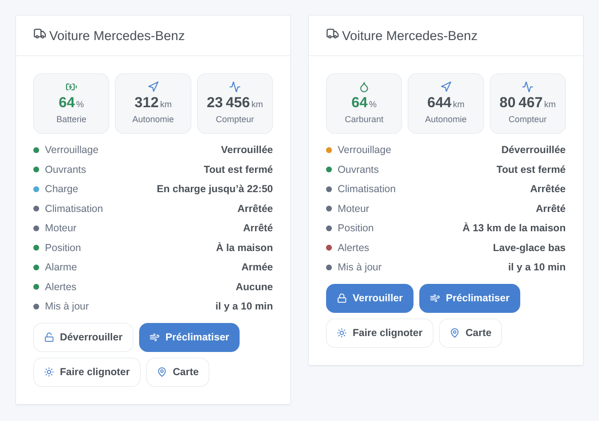

# Gladys Mercedes-Benz

[English](README.md) · **Français** · [Deutsch](README.de.md) · [Español](README.es.md)

[](LICENSE)
[](https://github.com/William-De71/gladys-mercedes-benz/releases)
[](https://github.com/William-De71/gladys-mercedes-benz/actions/workflows/release.yml)
[](https://gladysassistant.com)



Intégration externe de [Gladys Assistant](https://gladysassistant.com) pour les **voitures Mercedes-Benz** connectées à Mercedes me : batterie ou carburant, autonomie, kilométrage, verrouillage, ouvrants, charge, climatisation, alarme, pneus, position, avec des commandes, des scènes et un widget de tableau de bord. Elle dialogue avec les serveurs de l’application Mercedes me avec votre compte, comme l’intégration Home Assistant [mbapi2020](https://github.com/ReneNulschDE/mbapi2020).

Documentation utilisateur : [English](docs/en.md) · [Français](docs/fr.md) · [Deutsch](docs/de.md) · [Español](docs/es.md).

> Intégration communautaire, ni affiliée à Mercedes-Benz Group AG ni approuvée par elle. Les serveurs Mercedes me n’ont pas de documentation publique : Mercedes peut les modifier à tout moment.

## Fonctionnalités

- **Un appareil par voiture** du compte (voitures possédées et partagées) : batterie et autonomie électrique, carburant et autonomie, kilométrage, verrouillage, alarme antivol, portes, coffre, capot, fenêtres, toit ouvrant, câble de charge, charge en cours, état et puissance de charge, limite de charge, préclimatisation, pression des quatre pneus, entretien, alertes, distance du domicile.
- **Commandes** quand la voiture les accepte : verrouiller, déverrouiller (avec le code PIN de sécurité), préclimatisation (ou chauffage auxiliaire), limite de charge, faire clignoter les feux, klaxon, fermer les fenêtres.
- **Mises à jour en direct** : Mercedes pousse chaque changement par un websocket.
- **9 déclencheurs de scène**, **2 actions de scène** et **1 widget** de tableau de bord (ci-dessous).
- Un bouton **Diagnostic** qui écrit dans les journaux ce que remonte chaque voiture, sans VIN, plaque ni position.
- Quatre langues partout : anglais, français, allemand, espagnol.

## Fonctionnement





Du scan à une commande :



Mercedes bloque un compte dont le websocket reste ouvert trop longtemps dans la journée (HTTP 429, souvent jusqu’à minuit GMT). Comme mbapi2020, l’intégration ouvre des sessions courtes : elle lit les changements, ferme après 30 secondes de silence et rouvre après la pause des réglages (1 minute par défaut) ; elle reste ouverte moteur en marche ou quand une commande attend sa réponse. Tant que Mercedes refuse le websocket, les voitures sont lues par l’API REST toutes les 10 minutes.

La connexion est celle de l’application : e-mail, mot de passe, puis échange du code (OAuth2 + PKCE). L’intégration décline la proposition de passkey, accepte les conditions mises à jour quand Mercedes les demande, garde les jetons dans `/data/session.json` et se reconnecte seule quand la session prend fin (environ toutes les 18 heures). La double authentification ne peut pas fonctionner ainsi : utilisez un compte qui ne l’a pas.

### Transport

`transports: ["cloud"]` : tout passe par les serveurs Mercedes, la voiture n’est jamais jointe sur votre réseau. L’état de vos voitures (position comprise) vient du cloud Mercedes ; l’intégration envoie à Mercedes votre e-mail, votre mot de passe et les commandes. Le badge de transport d’une voiture indique `cloud`, `unreachable` quand Mercedes refuse le compte, et affiche le point orange du mode dégradé tant que le websocket est bloqué.

## Appareils et fonctionnalités

| Appareil              | Fonctionnalités (catégorie / type)                                                                                                                                                                                                                                                                                                                                                                                                                                                                                                                                                                                                                                                                                                                                                      |
| --------------------- | --------------------------------------------------------------------------------------------------------------------------------------------------------------------------------------------------------------------------------------------------------------------------------------------------------------------------------------------------------------------------------------------------------------------------------------------------------------------------------------------------------------------------------------------------------------------------------------------------------------------------------------------------------------------------------------------------------------------------------------------------------------------------------------- |
| Voiture Mercedes-Benz | batterie (`electrical-vehicle-battery` / `battery-level`), autonomie électrique (`battery-range-estimate`), niveau de carburant (`level-sensor` / `liquid-level-percent`), autonomie carburant et distance avant l’entretien (`distance-sensor` / `decimal`, km), kilométrage (`electrical-vehicle-state` / `odometer`), verrouillage et alarme (`electrical-vehicle-command`), portes, coffre, capot (`door-opened`), fenêtres, toit ouvrant (`window-opened`), pression des pneus (`tire-pressure`, bar), câble branché, charge en cours, puissance de charge, limite de charge (`electrical-vehicle-charge`), préclimatisation (`electrical-vehicle-climate` / `climate-on`), jours avant l’entretien (`duration`), état de la charge et alertes (`text`), distance du domicile (km) |

Une fonctionnalité apparaît dès que la voiture remonte sa valeur : relancez une découverte après les premières données s’il en manque une. Verrouillage, préclimatisation et limite de charge sont des commandes quand la voiture les accepte, en lecture seule sinon.

## Déclencheurs, actions de scène et widgets



- **Déclencheurs** : verrouillée ou déverrouillée, verrouillée mais ouverte, alarme antivol, moteur démarré ou arrêté, état de charge modifié, câble branché ou débranché, arrivée ou départ (maisons de Gladys avec une position, rayon du domicile des réglages), nouvelle alerte, problème de compte (mot de passe, code demandé, blocage, version d’appli refusée). Chaque déclencheur de voiture peut être filtré par voiture.
- **Actions** : envoyer une commande (attend jusqu’à 90 s la réponse de la voiture : `success`, `status`, `summary`), lire l’état (verrouillage, ouvrants, batterie, carburant, autonomie, charge, position, lien de carte, alertes, une phrase prête).
- **Widget** « Voiture Mercedes-Benz » : batterie ou carburant, autonomie, kilométrage, liste d’états, boutons verrouiller/déverrouiller, préclimatiser, faire clignoter, carte.

Exemples :

- Quand la voiture est verrouillée mais ouverte → envoyer une notification avec `{{triggerEvent.data.summary}}`.
- Quand l’état de charge devient « Chargée » → prévenir, et couper la prise de recharge.
- Les matins d’hiver à 7 h 30 en semaine → envoyer la commande « Lancer la préclimatisation ».
- Quand la voiture arrive à la maison → ouvrir la porte du garage et allumer l’éclairage de l’entrée.

## Prérequis

- Gladys Assistant **5.3.0** ou plus récent (mots-clés du catalogue de Gladys 5.3, widgets et scènes) : les instances plus anciennes ne peuvent pas installer l’intégration.
- Une voiture Mercedes-Benz connectée à Mercedes me (Mercedes me connect en Amérique du Nord), et le compte de l’application, connecté une fois dans l’appli, **sans double authentification**. Un second compte invité sur la voiture par son utilisateur principal est recommandé.
- Régions : Europe (aussi l’Inde et la Thaïlande), Amérique du Nord (voitures de 2019 et plus récentes), Asie-Pacifique (aussi l’Amérique latine). La Chine n’est pas prise en charge.

## Installation

- **Depuis le store** : Intégrations → Mercedes-Benz → Installer.
- **Depuis l’URL du dépôt** : Intégrations → intégration externe → `https://github.com/William-De71/gladys-mercedes-benz`.
- **Mode développeur** : lancez `npm start` avec les variables fournies par Gladys (voir Développement).

## Configuration

| Champ                     | Défaut      | Rôle                                                           |
| ------------------------- | ----------- | -------------------------------------------------------------- |
| E-mail / Mot de passe     | —           | Le compte Mercedes me (le mot de passe est un `secret`)        |
| Région                    | Europe      | Europe, Amérique du Nord, Asie-Pacifique                       |
| Code PIN de sécurité      | —           | Le code PIN de l’appli, seulement pour déverrouiller           |
| Pause entre deux lectures | 1 min       | 1 à 30 min entre deux sessions du websocket                    |
| Rayon du domicile         | 200 m       | Distance d’une maison de Gladys sous laquelle la voiture y est |
| Langue des textes         | automatique | Noms, états et résumés de scènes                               |
| Version de l’appli / SDK  | vide        | Seulement si Mercedes refuse la version intégrée (erreur 418)  |

## Utilisation

1. Renseignez le compte, cliquez sur **Enregistrer**, puis sur **Tester la connexion**.
2. **Découvrez**, puis ajoutez vos voitures.
3. Ajoutez le widget à un tableau de bord, et créez des scènes avec les déclencheurs et les actions.

## Développement

```bash
npm install
npm test                       # node --test, sans jamais toucher au réseau
npm run lint                   # ESLint
npm run format:check           # Prettier
npx github:GladysAssistant/integration-store . --skip-image-check
scripts/build-cover.sh         # cover.jpg depuis docs/assets/cover.svg
docs/illustrations/render.sh   # docs/assets/widgets.<langue>.png
```

En local, le SDK lit `GLADYS_HOST_API_URL`, `GLADYS_INTEGRATION_TOKEN` et `GLADYS_INTEGRATION_SELECTOR` (fournis par Gladys en mode développeur). `DEBUG=gladys-integration-sdk` affiche les journaux du SDK.

`src/mercedes/proto.json` est le schéma protobuf de l’appli, généré depuis mbapi2020 avec `scripts/proto/` (voir les commentaires). Les tests construisent leurs messages avec lui (voitures synthétiques, faux VIN) : étapes de connexion (passkey, 2FA, mauvais mot de passe, rafraîchissement, session stockée), sessions du websocket (acquittements, commandes, 429, 418), les deux formes de messages (VEP et VSU), les appareils (champs exigés par la Découverte, couples catégorie / type et unités du cœur), le widget (`validateWidgetContent`), les événements et sorties de scène, le manifeste, les quatre langues, le script de release, et toute l’intégration face au faux Gladys du SDK. `test/structure.test.js` fige chaque clé stockée par les utilisateurs.

## Processus de release


Chaque fusion sur `main` lance la CI, puis calcule la version à partir des [Conventional Commits](https://www.conventionalcommits.org/fr/) depuis le dernier tag : `feat` → mineure, `fix` / `perf` → correctif, `!` ou `BREAKING CHANGE` → majeure (une mineure sous 1.0.0) ; `docs`, `chore`, `ci`, `test`, `style`, `refactor`, `build` seuls ne publient rien. La section du changelog est générée, le tag poussé, l’image multi-architecture construite, puis `main` reçoit le commit de release, la GitHub Release est créée et un dernier job vérifie l’image publique, le validateur du store et le topic.

- Le titre de la pull request devient le commit de squash, puis la ligne du changelog : écrivez-le en anglais, pour l’utilisateur (`pr-title.yml` le vérifie). N’éditez jamais `CHANGELOG.md` à la main.
- La 1.0.0 est une décision : Actions → Release → Run workflow avec `release-as: 1.0.0`. `dry-run` affiche la version et les notes sans rien publier.
- **Branche protégée** : la release pousse son commit sur `main` avec `GITHUB_TOKEN`. Avec un ruleset sur `main`, ajoutez GitHub Actions à sa liste de contournement (ou poussez via une GitHub App), sinon le job de publication échoue avec des instructions.
- Après la première release, rendez public le package `ghcr.io` (Package settings → Change visibility), sinon Gladys ne peut pas le télécharger.

## Dépannage

Voir [docs/fr.md](docs/fr.md#dépannage). Signalez un problème avec les versions de Gladys et de l’intégration, le modèle, l’année et la région de la voiture, et les journaux après un clic sur **Diagnostic**.

## Contribuer

Issues et pull requests bienvenues. Lancez `npm run format:check && npm run lint && npm test` avant d’ouvrir une pull request, et gardez inchangés tous les external ids et clés stockées (voir [CLAUDE.md](CLAUDE.md)). Quand Mercedes change la version d’appli exigée, mettez à jour `src/mercedes/constants.js` d’après le projet mbapi2020.

## Sécurité

Voir [SECURITY.md](SECURITY.md) : signalez les vulnérabilités en privé. Le mot de passe et le code PIN sont des champs `secret`, jamais journalisés ; les jetons restent dans `/data/session.json` (mode 600) ; un VIN est raccourci dans les journaux, et le Diagnostic omet VIN, plaque et position.

## Captures à venir

Les images ci-dessus sont des illustrations, pas des captures d’écran. Les vraies captures iront dans `docs/assets/screenshots/` (PNG, 1280 × 800) : `configuration.png`, `discovery.png`, `device.png`, `scene.png`.

## Licence

[Licence Apache 2.0](LICENSE) — voir aussi [NOTICE](NOTICE). Le schéma protobuf `src/mercedes/proto.json` vient de mbapi2020 sous licence MIT ([PROTO-LICENSE](src/mercedes/PROTO-LICENSE)). Mercedes-Benz et Mercedes me sont des marques de Mercedes-Benz Group AG ; cette intégration communautaire n’y est pas affiliée. Merci à la documentation et au SDK de Gladys, ainsi qu’à René Nulsch et aux contributeurs de mbapi2020.
