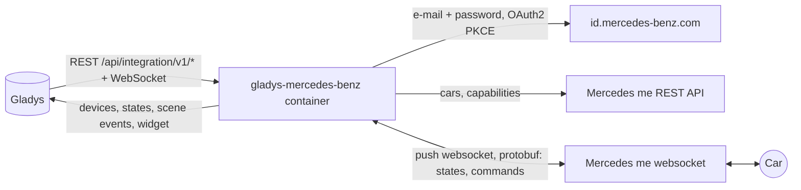
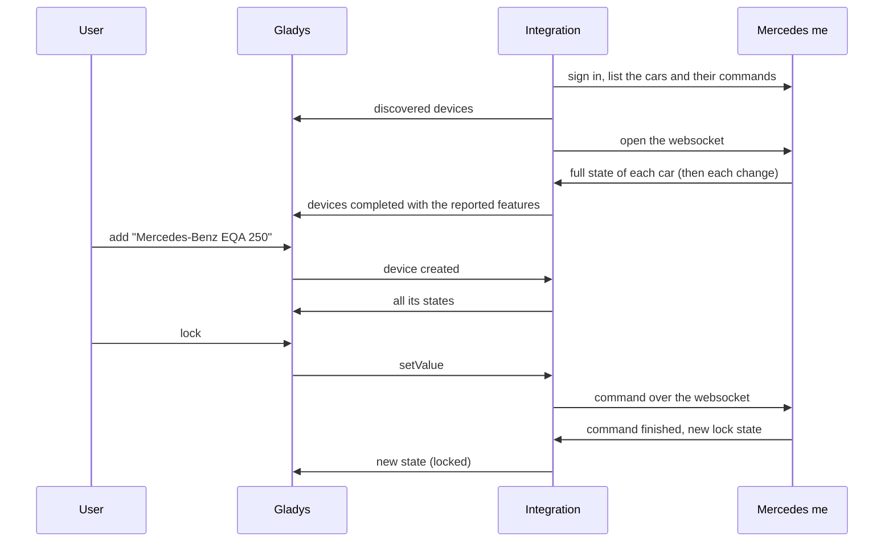
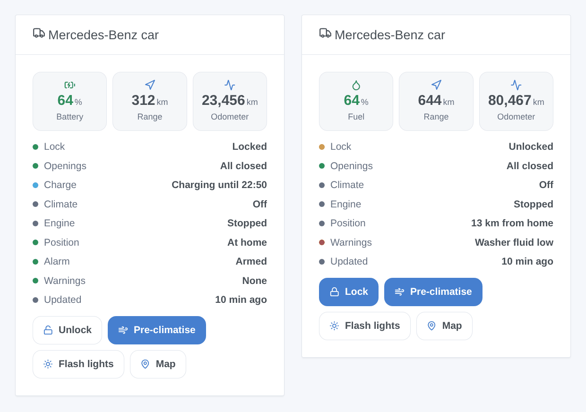

# Gladys Mercedes-Benz

**English** · [Français](README.fr.md) · [Deutsch](README.de.md) · [Español](README.es.md)

[](LICENSE)
[](https://github.com/William-De71/gladys-mercedes-benz/releases)
[](https://github.com/William-De71/gladys-mercedes-benz/actions/workflows/release.yml)
[](https://gladysassistant.com)


[Gladys Assistant](https://gladysassistant.com) external integration for **Mercedes-Benz cars** connected to Mercedes me: battery or fuel, range, odometer, lock, openings, charge, climate, alarm, tires, position, with commands, scenes and a dashboard widget. It talks to the servers of the Mercedes me app with your account, like the [mbapi2020](https://github.com/ReneNulschDE/mbapi2020) Home Assistant integration.

User documentation: [English](docs/en.md) · [Français](docs/fr.md) · [Deutsch](docs/de.md) · [Español](docs/es.md).

> Community integration, not affiliated with nor endorsed by Mercedes-Benz Group AG. The Mercedes me servers have no public documentation: Mercedes can change them at any time.

## Features

- **One device per car** of the account (own and shared cars): battery and electric range, fuel and range, odometer, lock, anti-theft alarm, doors, trunk, hood, windows, sunroof, charging cable, charging, charging status and power, charge limit, pre-climatisation, four tire pressures, service, warnings, distance from home.
- **Commands** where the car accepts them: lock, unlock (with the security PIN), pre-climatisation (or auxiliary heater), charge limit, flash the lights, horn, close the windows.
- **Live updates**: Mercedes pushes each change over a websocket.
- **9 scene triggers**, **2 scene actions** and **1 dashboard widget** (below).
- A **Diagnostic** button that writes what each car reports to the logs, without VIN, plate nor position.
- Four languages everywhere: English, French, German, Spanish.

## How it works




From the scan to a command:



Mercedes blocks an account whose websocket stays open too long in a day (HTTP 429, often until midnight GMT). Like mbapi2020, the integration opens short sessions: it reads the changes, closes after 30 seconds of silence and opens again after the pause of the settings (1 minute by default); it stays open while an engine runs or a command waits for its answer. While Mercedes refuses the websocket, the cars are read through the REST API every 10 minutes.

The sign-in is the one of the app: e-mail, password, then the code exchange (OAuth2 + PKCE). The integration declines the passkey offer, accepts the updated terms when Mercedes asks for them, keeps the tokens in `/data/session.json` and signs in again on its own when the session ends (about every 18 hours). Two-factor authentication cannot work this way: use an account without it.

### Transport

`transports: ["cloud"]`: everything goes through the Mercedes servers, the car is never reached on your network. The state of your cars (position included) comes from the Mercedes cloud; the integration sends Mercedes your e-mail, password and the commands. The transport badge of a car says `cloud`, `unreachable` when Mercedes refuses the account, and shows the orange dot of the degraded mode while the websocket is blocked.

## Devices and features

| Device            | Features (category / type)                                                                                                                                                                                                                                                                                                                                                                                                                                                                                                                                                                                                                                                                              |
| ----------------- | ------------------------------------------------------------------------------------------------------------------------------------------------------------------------------------------------------------------------------------------------------------------------------------------------------------------------------------------------------------------------------------------------------------------------------------------------------------------------------------------------------------------------------------------------------------------------------------------------------------------------------------------------------------------------------------------------------- |
| Mercedes-Benz car | battery (`electrical-vehicle-battery` / `battery-level`), electric range (`battery-range-estimate`), fuel level (`level-sensor` / `liquid-level-percent`), fuel range and distance to service (`distance-sensor` / `decimal`, km), odometer (`electrical-vehicle-state` / `odometer`), lock and alarm (`electrical-vehicle-command`), doors, trunk, hood (`door-opened`), windows, sunroof (`window-opened`), tire pressures (`tire-pressure`, bar), cable plugged, charging, charging power, charge limit (`electrical-vehicle-charge`), pre-climatisation (`electrical-vehicle-climate` / `climate-on`), days to service (`duration`), charging status and warnings (`text`), distance from home (km) |

A feature appears once the car reports its value: scan again after the first data if one is missing. Lock, pre-climatisation and charge limit are commands when the car accepts them, read-only otherwise.

## Scene triggers, actions and widgets



- **Triggers**: locked or unlocked, locked but left open, anti-theft alarm, engine started or stopped, charging status changed, cable plugged or unplugged, arrived home or left (houses of Gladys with a position, home radius of the settings), new warning, account problem (password, code asked, blocked, app version refused). Each car trigger can be filtered by car.
- **Actions**: send a command (waits up to 90 s for the car's answer: `success`, `status`, `summary`), read the status (lock, openings, battery, fuel, range, charge, position, map link, warnings, a ready sentence).
- **Widget** "Mercedes-Benz car": battery or fuel, range, odometer, status list, buttons lock/unlock, pre-climatise, flash the lights, map.

Examples:

- When the car is locked but left open → send a notification with `{{triggerEvent.data.summary}}`.
- When the charging status becomes "Charged" → notify, and switch the charging socket off.
- On winter mornings at 7:30 on working days → send the command "Start the pre-climatisation".
- When the car arrives home → open the garage door and switch the porch light on.

## Requirements

- Gladys Assistant **5.3.0** or later (catalog keywords of Gladys 5.3, widgets and scenes): older instances cannot install the integration.
- A Mercedes-Benz car connected to Mercedes me (Mercedes me connect in North America), and the account of the app, signed in once in the app, **without two-factor authentication**. A second account invited to the car by its main user is recommended.
- Regions: Europe (also India and Thailand), North America (cars of 2019 and later), Asia-Pacific (also Latin America). China is not supported.

## Installation

- **From the store**: Integrations → Mercedes-Benz → Install.
- **From the repository URL**: Integrations → external integration → `https://github.com/William-De71/gladys-mercedes-benz`.
- **Developer mode**: run `npm start` with the variables given by Gladys (see Development).

## Configuration

| Field                    | Default   | Meaning                                                       |
| ------------------------ | --------- | ------------------------------------------------------------- |
| E-mail / Password        | —         | The Mercedes me account (the password is a `secret`)          |
| Region                   | Europe    | Europe, North America, Asia-Pacific                           |
| Security PIN             | —         | The PIN of the app, only to unlock from Gladys                |
| Pause between readings   | 1 min     | 1 to 30 min between two websocket sessions                    |
| Home radius              | 200 m     | Distance from a house of Gladys under which the car is home   |
| Language of the texts    | automatic | Names, states and scene summaries                             |
| App version / SDK (Adv.) | empty     | Only if Mercedes refuses the built-in app version (error 418) |

## Usage

1. Fill in the account, click **Save**, then **Test the connection**.
2. **Discover**, then add your cars.
3. Add the widget to a dashboard, and build scenes with the triggers and actions.

## Development

```bash
npm install
npm test                       # node --test, never touches the network
npm run lint                   # ESLint
npm run format:check           # Prettier
npx github:GladysAssistant/integration-store . --skip-image-check
scripts/build-cover.sh         # cover.jpg from docs/assets/cover.svg
docs/illustrations/render.sh   # docs/assets/widgets.<lang>.png
```

Locally, the SDK reads `GLADYS_HOST_API_URL`, `GLADYS_INTEGRATION_TOKEN` and `GLADYS_INTEGRATION_SELECTOR` (given by Gladys in developer mode). `DEBUG=gladys-integration-sdk` shows the SDK logs.

`src/mercedes/proto.json` is the protobuf schema of the app, generated from mbapi2020 with `scripts/proto/` (see the comments there). The tests build their messages with it (synthetic cars, fake VINs): sign-in steps (passkey, 2FA, wrong password, refresh, stored session), websocket sessions (acknowledgements, commands, 429, 418), both message shapes (VEP and VSU), the devices (the fields the Discovery screen requires, category / type pairs and units of the core), the widget (`validateWidgetContent`), the scene events and outputs, the manifest, the four languages, the release script, and the whole integration against the fake Gladys of the SDK. `test/structure.test.js` freezes every key users store.

## Release process


Every merge on `main` runs the CI, then computes the version from the [Conventional Commits](https://www.conventionalcommits.org/) since the last tag: `feat` → minor, `fix` / `perf` → patch, `!` or `BREAKING CHANGE` → major (a minor below 1.0.0); `docs`, `chore`, `ci`, `test`, `style`, `refactor`, `build` alone publish nothing. The changelog section is generated, the tag pushed, the multi-architecture image built, then `main` receives the release commit, the GitHub Release is created and a last job checks the public image, the store validator and the topic.

- The pull request title becomes the squash commit, then the changelog line: write it in English, for the user (`pr-title.yml` checks it). Never edit `CHANGELOG.md` by hand.
- 1.0.0 is a decision: Actions → Release → Run workflow with `release-as: 1.0.0`. `dry-run` shows the version and the notes without publishing.
- **Protected branch**: the release pushes its commit to `main` with `GITHUB_TOKEN`. With a ruleset on `main`, add GitHub Actions to its bypass list (or push through a GitHub App), otherwise the publish job fails with instructions.
- After the first release, make the `ghcr.io` package public (Package settings → Change visibility), or Gladys cannot pull it.

## Troubleshooting

See [docs/en.md](docs/en.md#troubleshooting). Report issues with the versions of Gladys and of the integration, the model, year and region of the car, and the logs after a click on **Diagnostic**.

## Contributing

Issues and pull requests are welcome. Run `npm run format:check && npm run lint && npm test` before opening a pull request, and keep every external id and stored key unchanged (see [CLAUDE.md](CLAUDE.md)). When Mercedes changes the app version it requires, update `src/mercedes/constants.js` after the mbapi2020 project.

## Security

See [SECURITY.md](SECURITY.md): report vulnerabilities privately. The password and the PIN are `secret` fields, never logged; the tokens stay in `/data/session.json` (mode 600); a VIN is shortened in the logs, and the Diagnostic leaves out VIN, plate and position.

## Screenshots to come

The images above are illustrations, not screenshots. Real screenshots will go in `docs/assets/screenshots/` (PNG, 1280 × 800): `configuration.png`, `discovery.png`, `device.png`, `scene.png`.

## License

[Apache License 2.0](LICENSE) — see also [NOTICE](NOTICE). The protobuf schema `src/mercedes/proto.json` comes from mbapi2020 under the MIT License ([PROTO-LICENSE](src/mercedes/PROTO-LICENSE)). Mercedes-Benz and Mercedes me are trademarks of Mercedes-Benz Group AG; this community integration is not affiliated with it. Thanks to the Gladys documentation and SDK, and to René Nulsch and the contributors of mbapi2020.
